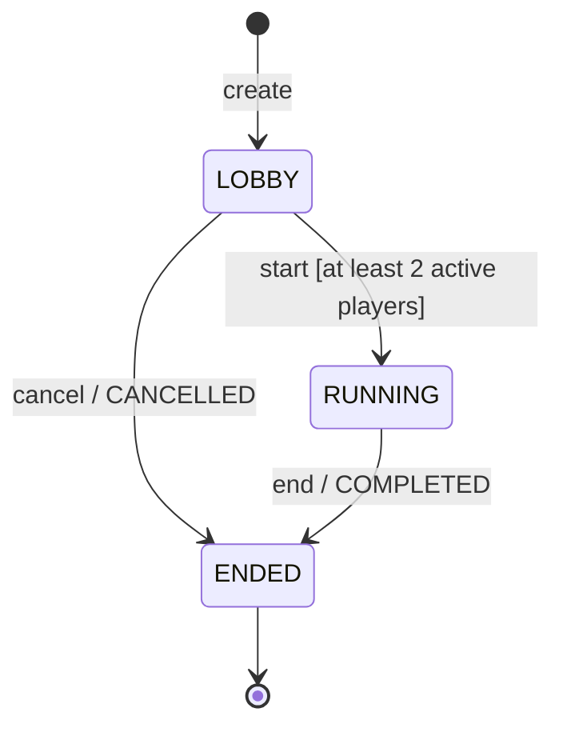

# Milestone 4 — Multiplayer simulation

The project owner creates lobbies and controls synthetic players through a REST API. These are game sessions (`game_sessions`), separate from login sessions (`auth_sessions`). No game engine, game server, matchmaking, WebSockets, or Epic Online Services integration is implied. Analytics is the next slice.

## State machine

New players join only in LOBBY, up to the capacity of 2–32. Departures are allowed in LOBBY and RUNNING. A running session remains running even if everyone leaves; its owner explicitly ends it. End/cancel disconnect every remaining player atomically. ENDED is terminal; another playtest requires a new session.

Names are trimmed, nonempty, and bounded: session names at 80 characters, player names at 40. Player names need not be unique. Participants represent simulated connections, not authenticated user accounts.

## Database

Migration `004_game_sessions.sql` adds:

| Table                  | Columns and constraints                                                                                                                          |
| ---------------------- | ------------------------------------------------------------------------------------------------------------------------------------------------ |
| `game_sessions`        | Server-generated UUID `id`, `project_id` FK, `name`, integer `max_players`, `state`, `created_at`, nullable `started_at`/`ended_at`/`end_reason` |
| `session_participants` | Composite PK `(session_id, id)`, session FK, client-generated UUID `id`, `name`, `joined_at`, nullable `left_at`                                 |

All timestamps use `timestamptz` and are displayed in UTC. Checks enforce capacity bounds, trimmed names, timestamp order, and the valid combinations of state/timestamps/end reason. Both foreign keys cascade with their parent. Participants remain stored after leaving; the API returns only the active roster. This preserves membership history for later analytics without an event bus in this phase.

Indexes support `(project_id, created_at DESC, id DESC)` session pagination, open sessions per project, and active participants ordered by join time. Counts and the active roster are computed together in a single SQL snapshot, avoiding a separate mutable player counter.

Capacity, minimum players, and cross-table lifecycle rules are enforced by the service transaction. SQL checks alone cannot express these cross-row rules. Direct database writes must not bypass this service; the migration owner is not a public API.

## REST contract

All paths below are relative to `/api/v1/projects/:projectId/sessions`. All require authentication and owner-scoped access; mutations require the existing CSRF cookie/header and exact Origin. Responses are `no-store`.

| Method/path                         | Input                                              | Success                     |
| ----------------------------------- | -------------------------------------------------- | --------------------------- |
| `POST /`                            | `{ name, maxPlayers }`                             | 201 `{ session }`           |
| `GET /`                             | `limit=1..50` (default 10), optional UUID `cursor` | 200 `{ items, nextCursor }` |
| `GET /:id`                          | Session UUID                                       | 200 `{ session }`           |
| `POST /:id/players`                 | `{ id: clientGeneratedUUID, name }`                | 200 `{ session }`           |
| `POST /:id/players/:playerId/leave` | `{}`                                               | 200 `{ session }`           |
| `POST /:id/start`                   | `{}`                                               | 200 `{ session }`           |
| `POST /:id/end`                     | `{}`                                               | 200 `{ session }`           |
| `POST /:id/cancel`                  | `{}`                                               | 200 `{ session }`           |

Session summaries contain `id`, `projectId`, `name`, `maxPlayers`, `activePlayers`, `state`, `createdAt`, `startedAt`, `endedAt`, `endReason`. Details and mutation responses also contain `participants: [{ id, name, joinedAt }]`. Lists use keyset pagination on immutable creation time and UUID, scoped to the same owner/project. No exact total or arbitrary page-number navigation is provided.

400 means invalid input/action/cursor; 401 means no valid authentication; 403 means rejected CSRF/origin. Another owner's project or session is indistinguishable from missing data (404). Unknown players also return 404. Domain conflicts return 409 with a stable code such as `SESSION_FULL`, `LOBBY_REQUIRED`, `NOT_ENOUGH_PLAYERS`, `INVALID_TRANSITION`, `PLAYER_ID_CONFLICT`, `PLAYER_LEFT`, or `PROJECT_ARCHIVED`.

Example sequence: create a lobby → POST two distinct player UUIDs → start → optionally leave → end. A join retry must keep the same UUID **and** trimmed name.

## Concurrency and retries

Each session mutation takes a shared project row lock (`FOR SHARE`) before an exclusive session row lock (`FOR UPDATE`). Project archival takes an exclusive project lock, then checks for LOBBY/RUNNING sessions. An open session blocks archival with `OPEN_SESSIONS` (409); end or cancel it first. Archived projects allow reads but reject all session mutations until restored.

The project-first lock order prevents an archive/create race and avoids reversing lock acquisition. Shared project locks permit independent sessions in the same project to progress concurrently. The session lock serializes the capacity check with the participant insert: two contenders for the final slot cannot both join. Short transactions and the existing database timeouts bound the cost; a heavily contended session may time out and require refresh/retry.

Joining with an already-active UUID and the same name is idempotent, even after the lobby starts. A different name conflicts; a UUID that already left cannot rejoin. Use a new UUID for a new connection. Concurrent identical joins create one row. Repeated leave is a no-op. Repeated start on RUNNING or repeated end/cancel with the same terminal reason preserves the original timestamps. Incompatible transitions conflict. Archive restrictions are checked before these retry rules.

These operations express a desired state; they do not require a version field. Project text editing still uses versions because it must detect stale drafts. We do not automatically retry writes after network errors.

Creation is **not idempotent**: the UI preserves input and tells the user to inspect the session list after an ambiguous failure. Add-player retries reuse the same UUID while that form remains mounted and its submitted name is unchanged. The UUID is not persisted across a reload; after reload, inspect the roster before adding again. API clients that need durable retry behavior should retain their UUIDs.

## Frontend and review checkpoint

Next.js server pages load owner-scoped project/session data with no cache. The simulator is a Client Component that applies authoritative mutation responses and offers manual refresh. Multiple tabs can show stale data until refreshed; the API still enforces every rule. Errors retain input and receive keyboard focus; action feedback is announced; focus returns to the persistent refresh button when an action removes its own control.

Create a project, open **Multiplayer sessions**, create a lobby, add two players, start it, remove one, and end it. Reload to verify persistence. An empty lobby can be cancelled so it does not block archival indefinitely.

Review exercises before analytics:

1. Trace two simultaneous requests for the final slot. Which lock ensures only one commits?
2. Explain why locking only the session would not protect the project archive/create race.
3. Drop a successful join response, then retry with the same UUID. Why is another player not created?
4. Distinguish login sessions, game sessions, and simulated participants in the schema.
5. Explain which facts the membership timestamps preserve and which they do not: there are no ping, packet loss, gameplay, or heartbeat measurements.
6. Define completed-session duration using `started_at` and `ended_at`, excluding cancelled lobbies, before implementing analytics.

Per-owner quotas, retention, background cleanup, real player authentication and production traffic controls remain future decisions. This local MVP does not claim real multiplayer networking.
